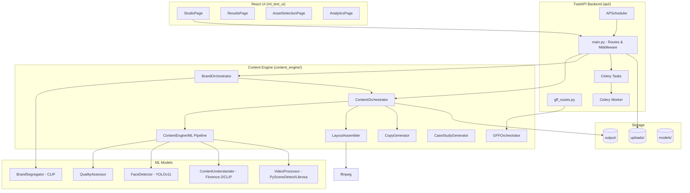
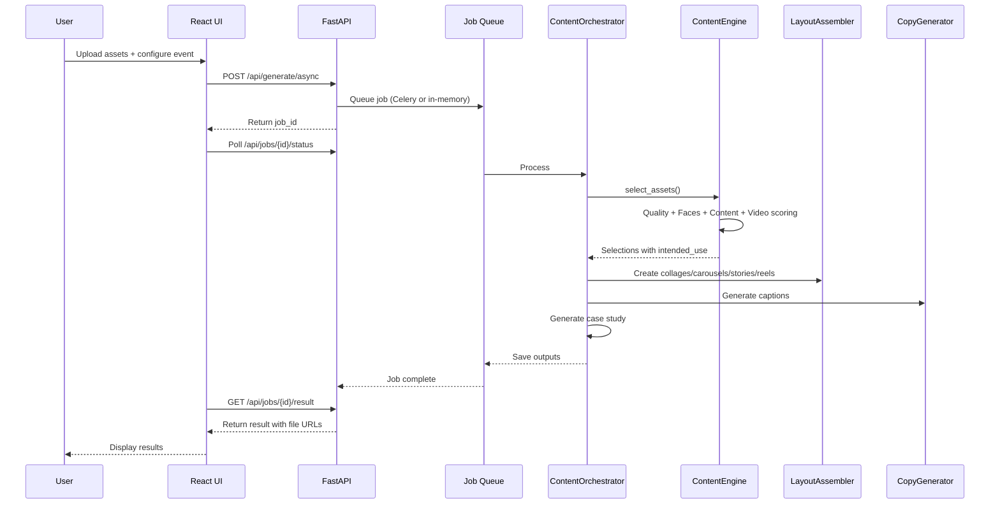

# ARCHITECTURE

## System Overview



## Content Generation Data Flow



## Design/Composition Data Flow

```mermaid
sequenceDiagram
    participant ML as ContentEngine
    participant Orch as Orchestrator
    participant Layout as LayoutAssembler
    participant PIL as Pillow
    participant FFmpeg as ffmpeg
    
    ML-->>Orch: Selections (intended_use: collage/story/reel)
    Orch->>Layout: Route by intended_use
    
    alt intended_use = collage
        Layout->>PIL: smart_crop() with face detection
        Layout->>PIL: create_linkedin_collage() - arrange in grid
        PIL-->>Orch: linkedin_collage.jpg
    alt intended_use = story
        Layout->>PIL: create_stories() - adapt horizontal if needed
        Layout->>PIL: Add text overlay
        PIL-->>Orch: instagram_story_*.jpg
    alt intended_use = reel
        Layout->>FFmpeg: Extract highlights from video
        Layout->>FFmpeg: Concatenate with xfade transitions
        FFmpeg-->>Orch: instagram_reel.mp4
    end
```

## Service Boundaries

| Service | Type | Responsibility |
|---------|------|----------------|
| **api/main.py** | FastAPI App | HTTP routing, validation, middleware, job orchestration, file handling |
| **api/gff_routes.py** | Router | GFF 2025 brand segregation endpoints |
| **api/tasks.py** | Celery Tasks | Background job definitions |
| **api/worker.py** | Celery Worker | Worker process |
| **api/scheduler.py** | APScheduler | In-process job scheduling/fallback |
| **content_engine/orchestrator.py** | Orchestrator | Main pipeline coordination |
| **content_engine/brand_orchestrator.py** | Orchestrator | Brand-aware pipeline |
| **content_engine/gff/orchestrator_gff.py** | Orchestrator | GFF full pipeline |
| **content_engine/pipeline.py** | ML Orchestrator | Coordinates all ML models |
| **content_engine/layout_assembler.py** | Service | Image/video composition |
| **content_engine/copy_generator.py** | Service | Caption generation |
| **content_engine/brand_segregator.py** | Service | CLIP-based brand matching |

## API Contracts

Key endpoints:
- `POST /api/generate/async` - Submit async generation job
- `GET /api/jobs/{job_id}/status` - Job status
- `GET /api/jobs/{job_id}/result` - Job results
- `POST /api/generate/fast` - Fast generation with brand mode support
- `POST /api/generate/custom` - Custom generation with layout choices
- `POST /api/layout/preview` - Preview layouts
- `POST /api/gff/process` - GFF pipeline
- `POST /api/gff/process-upload` - GFF upload endpoint
- `POST /api/captions/regenerate` - Regenerate captions with LLM

## Persistence

- **Filesystem only** - No database (Postgres, MongoDB, etc.) found
- **Uploads**: Saved to `settings.upload_dir` (default `uploads/`)
- **Outputs**: Saved to `settings.output_dir` (default `output/`) organized by event/brand
- **Models**: Cached by HuggingFace in standard locations or `MODEL_CACHE_DIR`

## External Integrations

| Integration | Type | Usage | Required |
|-------------|------|-------|----------|
| **HuggingFace Hub** | Model downloads | Florence-2, YOLOv11 face model, CLIP models | Yes for first run |
| **Groq API** | LLM | Caption regeneration | Optional (falls back to templates) |
| **Redis** | Message broker | Celery jobs | Optional (falls back to in-memory) |
| **FFmpeg** | Video processing | Reel creation, video encoding | Required for video features |
| **libmagic** | File validation | MIME type detection | Required by python-magic |

## Configuration Dependencies

All config via environment variables read by `config.py`. Key deps:
- API settings, CORS origins
- Storage paths
- ML thresholds (face confidence, quality, brand similarity)
- Redis/Celery settings
- Groq API key/model
- File type restrictions, size limits
- Cleanup retention
